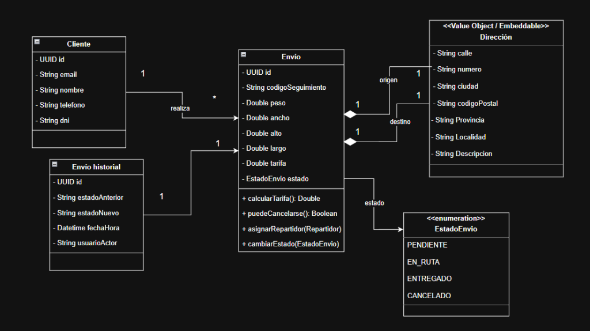

# 📦 Shipment-Service (LogiTrack)

[](https://adoptium.net/)
[](https://spring.io/projects/spring-boot)
[](https://spring.io/projects/spring-cloud)
[](https://www.mysql.com/)

Microservicio transaccional del ecosistema **LogiTrack (LazyHawk)** encargado del ciclo de vida de los envíos, cálculo de tarifas, gestión de clientes y coordinación de asignación de repartidores mediante comunicación inter-servicio resiliente.

---

## 📌 Descripción General

**Shipment-Service** constituye el núcleo de negocio logístico del sistema: registra envíos, calcula tarifas según peso y dimensiones, administra el flujo de estados del paquete (`PENDIENTE` → `EN_RUTA` → `ENTREGADO` / `CANCELADO`), mantiene un historial inmutable de auditoría y se comunica con `courier-service` mediante **OpenFeign y Resilience4j** para verificar y asignar repartidores activos.

El microservicio está construido bajo principios de Clean Code, arquitectura en capas, persistencia relacional con Spring Data JPA y observabilidad distribuida con Zipkin.

---

## 📐 Diagrama de Dominio / UML

<p align="center">
  
</p>

---

## 🎯 Alcance Funcional

### 1. Gestión de Clientes
- Alta y registro de clientes.
- Consulta de clientes por ID y listado general.

### 2. Gestión de Envíos
- Registro de un nuevo envío (asociado a cliente, dirección de origen, dirección de destino, peso y dimensiones).
- Cálculo automático de tarifas logísticas según peso y dimensiones.
- Generación de código único de seguimiento (*tracking code*).
- Consulta individual (por ID o código de seguimiento) y listados filtrados por estado.
- Cancelación de envíos (permitida únicamente cuando se encuentra en estado `PENDIENTE`).

### 3. Máquina de Estados y Auditoría
- Transición estricta de estados:
  $$\text{PENDIENTE} \longrightarrow \text{EN\RUTA} \longrightarrow \text{ENTREGADO}$$
  $$\text{PENDIENTE} \longrightarrow \text{CANCELADO}$$
- Registro automático en `HistorialEnvio` con cada cambio de estado (trazabilidad, timestamps y usuario).

### 4. Integración con Courier-Service (Inter-Servicio)
- Consulta y validación de existencia y estado activo de repartidores vía cliente **OpenFeign**.
- Asignación de repartidor a envíos en estado `PENDIENTE`.
- Tolerancia a fallos y resiliencia implementada con **Resilience4j** (Circuit Breaker y TimeLimiter).

---

## 🛠️ Stack Tecnológico

| Tecnología | Propósito |
| :--- | :--- |
| **Java 25** | Plataforma de desarrollo principal |
| **Spring Boot 4.1.2** | Framework base del microservicio |
| **Spring Cloud 2025.1.4** | Config Server, Eureka Client y OpenFeign |
| **Spring Data JPA / Hibernate** | Persistencia relacional |
| **MySQL 8.4** | Base de datos (`shipment_db`) |
| **Resilience4j** | Patrones de tolerancia a fallos (Circuit Breaker) |
| **Micrometer + Zipkin** | Trazabilidad distribuida de extremo a extremo |
| **Springdoc OpenAPI 3** | Documentación y contratos Swagger |
| **JUnit 5 + Mockito** | Pruebas unitarias y de integración |

---

## 🏛️ Estructura del Proyecto

El proyecto sigue una arquitectura en capas desacoplada:

```text
com.logitrack.shipmentservice
├── cliente                  # Clientes HTTP inter-servicio
│   └── courier              # Feign Client y DTOs para courier-service
├── config                   # Beans de configuración (OpenAPI, Feign, etc.)
├── controlador              # Controladores REST (@RestController)
├── dominio
│   ├── dto                  # DTOs de Request y Response
│   ├── entidad              # Entidades JPA (Envio, Cliente, HistorialEnvio, etc.)
│   ├── enumerador           # Enums de dominio (EstadoEnvio, etc.)
│   ├── evento               # Eventos del dominio
│   ├── exception            # Excepciones de negocio y @RestControllerAdvice
│   └── valueObject          # Value Objects (@Embeddable Direccion, Dimensiones)
├── repositorio              # Interfaces Spring Data JPA
├── servicio                 # Lógica de negocio (EnvioService, ClienteService)
└── ShipmentServiceApplication.java
```

---

## 🚀 Despliegue y Ejecución

### Opción 1: En Ecosistema con Docker Compose (Recomendado)
El despliegue oficial se orquesta de forma integrada junto al resto de microservicios desde el repositorio `logitrack-infra`:

```bash
cd ../logitrack-infra
docker compose up -d
```

### Opción 2: Ejecución Local en Desarrollo
1. Asegurarse de tener corriendo Config Server (`:8085`), Eureka Server (`:8065`) y MySQL (`:3309`).
2. Iniciar el servicio mediante el Maven Wrapper:
```bash
./mvnw spring-boot:run
```

---

## 🧪 Pruebas Automatizadas

Ejecutar la suite de pruebas unitarias (servicios, máquina de estados, validaciones de tarifas y DTOs):

```bash
./mvnw test
```

---

## 👥 Autores
* **Mamani, Luis Carlos Manuel** - [LuisMPlus](https://github.com/LuisMPlus)
* **Maygua Altamirano, Pio Roman** - [95670446-maker](https://github.com/95670446-maker)
* **Mamani Leandro** - [leoM2022](https://github.com/leoM2022)

*Proyecto LogiTrack (LazyHawk) · DAAS 2026 · Universidad Nacional de Jujuy (UNJu)*
